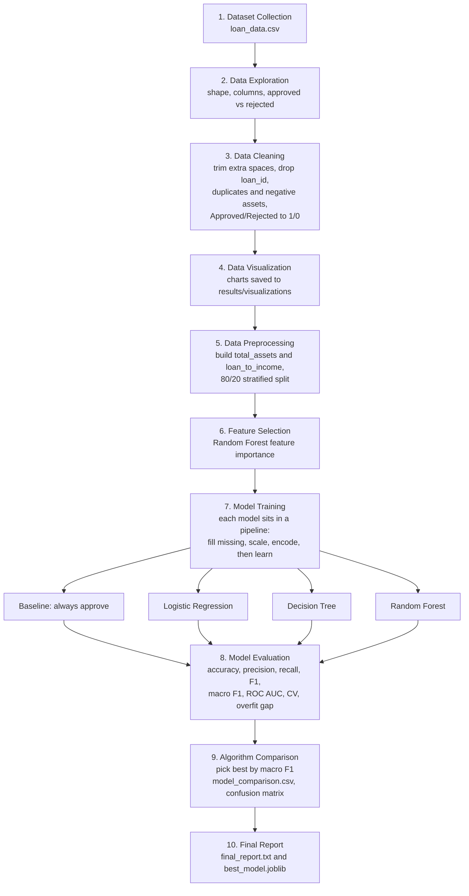

# Project Workflow

This document shows how data moves through the Loan Approval Prediction project, from the raw file to the final report.

## Workflow Diagram



## Phase Details

| Phase | Input | What happens | Output |
|---|---|---|---|
| 1. Dataset Collection | `dataset/loan_data.csv` | Load the file, remove stray spaces and check the expected columns exist | Raw DataFrame |
| 2. Data Exploration | Raw DataFrame | Check shape, types, statistics, approved vs rejected counts | Understanding of the data |
| 3. Data Cleaning | Raw DataFrame | Trim extra spaces in names and text, drop `loan_id`, duplicates and rows with negative asset values, turn Approved/Rejected into 1/0 | Clean DataFrame |
| 4. Data Visualization | Clean DataFrame | Plot CIBIL score by decision, approval rates by score band, education and more, plus income and loan amount charts | PNG charts |
| 5. Data Preprocessing | Clean DataFrame | Build `total_assets` and `loan_to_income`; split into train (80%) and test (20%) with the same approved/rejected ratio in both | `X_train`, `X_test`, `y_train`, `y_test` |
| 6. Feature Selection | Training data | Rank the features with Random Forest importance | Importance chart |
| 7. Model Training | Training data | Fit the baseline and three models, each inside a pipeline | Four trained pipelines |
| 8. Model Evaluation | Trained pipelines, test data | Calculate all metrics, 5-fold cross-validation and the train-vs-test gap | Scores per model |
| 9. Algorithm Comparison | Scores per model | Rank by macro F1, draw the confusion matrix and ROC curves, save the best model | `model_comparison.csv`, charts, `best_model.joblib` |
| 10. Final Report | Comparison table | Summarize the best model and how it handles rejected loans | `final_report.txt` |

## Key Ideas

### Train vs test
The data is split once, in phase 5:

- **Training data (80%)**: the models learn patterns from this.
- **Testing data (20%)**: kept hidden during training and used only in phase 8, so the scores honestly show how the models handle new applicants.

### The pipeline
Each model is a pipeline that does these steps in order:

1. Fill any missing numbers with the median and missing text with the most common value.
2. Scale the numbers and turn text columns into 0/1 columns.
3. Let the classifier learn.

Because the fill-in values are learned from training data only, nothing from the test set leaks into training.

### The baseline
The "always approve" baseline shows what a lazy model scores. A real model is only useful if it clearly beats it, especially on rejected loans.

## How to Run the Whole Workflow

```bash
pip install -r requirements.txt
python main.py
```

## Folder Flow

```
dataset/loan_data.csv  -->  main.py  -->  results/
                                           ├── visualizations/*.png
                                           ├── model_comparison.csv
                                           ├── final_report.txt
                                           └── best_model.joblib
```
